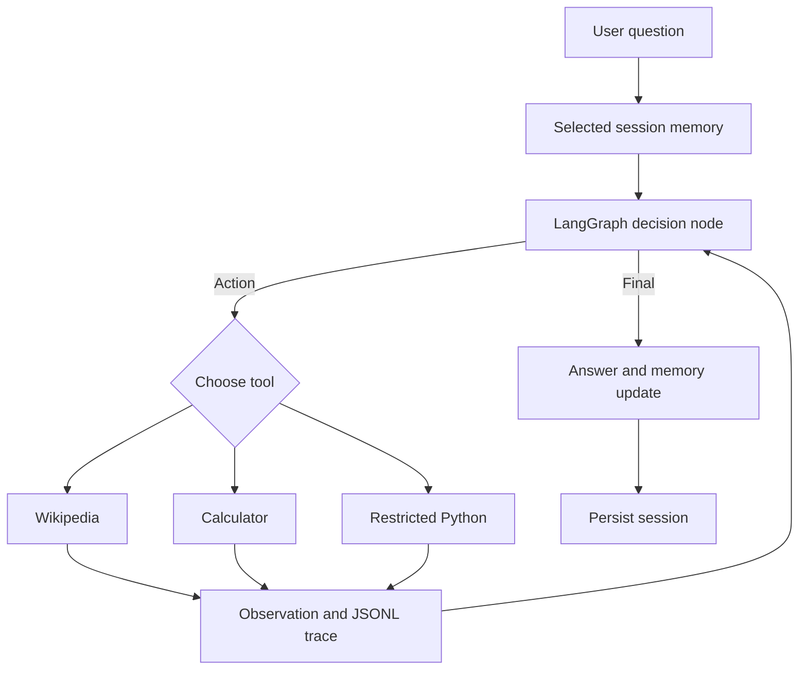

# Tool-Using Research Agent with Memory (Problem Statement 5)

Complete Python mini-project implementing an **autonomous ReAct research agent using LangGraph**, a **100-question HotpotQA** comparison against a single-prompt Chain-of-Thought (CoT) baseline, and **buffer / summary / entity memory**. It uses **Ollama on your own Windows laptop for free**. No paid OpenAI API key is necessary.

**This submission copy includes the user's genuine completed 100-question benchmark.**
Read `RESULTS_SUMMARY.md` for the measured 7.0% ReAct and 15.0% CoT exact-match
accuracy, token usage, abstentions and limitations. The `output/final_100/`
folder contains the provided result data. The four-turn memory-comparison
measurements are included in `output/memory_comparison/memory_comparison.json`.
All **100 per-question JSONL trace files** are now included at
`output/final_100/traces/`. Their file IDs match the 100 ReAct result IDs.

## Fastest way to run your final project

1. **Extract the standalone ZIP to any new location.** Open the extracted `Final_Submission_With_Results` folder. Your old project does not need to be changed, merged, replaced or deleted.
2. Open the new folder and double-click **`START_HERE.bat`**. On the first launch, it sets up a new Python environment inside that same folder and installs the included requirements. Your existing Ollama model remains available.
3. Use menu **1** to verify Ollama, **2** to check Wikipedia, **3** to chat, **4** to compare the three memories, **5** to run a short benchmark, **6** for all 100 questions, and **7** to regenerate the report with genuine results.
4. Next time, double-click `START_HERE.bat` again. It reuses the Python environment it already created.

The pilot and full runs save `comparison.csv` plus `summary.json`; the full run is free but may take hours. Hard multi-hop questions can still be answered incorrectly by a small local model; the software records abstentions and incorrect answers honestly.

## What is included

| Required deliverable | Implementation | Proof/output |
| --- | --- | --- |
| ReAct agent | `research_agent/react_agent.py` | Stepwise Thought-Action-Observation traces (JSONL) |
| Wikipedia search | `research_agent/tools.py` | Live search snippets, article extracts and URLs |
| Calculator | `research_agent/tools.py` | Restricted arithmetic evaluator (no unsafe eval) |
| Python execution | `research_agent/tools.py` + `python_runner.py` | Restricted numerical code in a separate child process |
| Buffer memory | `research_agent/memory.py` | Original Q/A turn history |
| Summary memory | `research_agent/memory.py` | Rolling model-written summary |
| Entity memory | `research_agent/memory.py` | Model-extracted named entity/fact map |
| Memory comparison | `research_agent/session.py` | Per-turn JSON + comparison CSV |
| 100 HotpotQA validation questions | `research_agent/hotpotqa.py` | Deterministic downloaded JSON, IDs and gold answers |
| CoT baseline, accuracy & efficiency | `research_agent/evaluation.py`, `metrics.py` | Per-method JSONL, summary JSON, comparison CSV |
| Optional chat web app | `app.py` | Interactive session, selectable memory and trace viewer |
| Validation | `tests/` | `pytest -q` |
| Free local AI | `research_agent/llm.py` | Ollama + Qwen2.5 3B, zero OpenAI API charges |

## Free installation on Windows 11

If Ollama is already installed (as in your case), do **not** reinstall it. You only need to download a local model once.

**Step 1 - Download the free local model**

Open Command Prompt (CMD) and enter:

```bat
ollama pull qwen2.5:3b
ollama list
```

`qwen2.5:3b` is approximately **1.9 GB**. The smaller `qwen2.5:1.5b` is approximately **986 MB**, but may be less accurate. To use the smaller model, run `ollama pull qwen2.5:1.5b`, then edit `OLLAMA_MODEL=qwen2.5:1.5b` in `.env`. Source: https://ollama.com/library/qwen2.5

Ollama must be running in the background. If the command cannot connect, launch Ollama from the Windows Start menu, or start the server using `ollama serve` if needed.

**Step 2 - Install/update Python packages**

Extract the updated ZIP. Double-click **`SETUP_WINDOWS.bat`**. This updates the packages needed for the free local model.

If you already have the project in `D:\5TH SEM\Prompt\research_agent_project`, you can replace the project source files with the updated ZIP files **without overwriting any personal `.env` or existing `output/` files**. The new version defaults to Ollama, even if your old `.env` still contains `OPENAI_API_KEY`.

Or use CMD manually from the project folder:

```bat
.venv\Scripts\activate
python -m pip install -r requirements.txt
python -m research_agent.cli check-model
```

If you do not have a `.env` file, create one from the new example by running `copy .env.example .env`. Its contents should be:

```env
LLM_PROVIDER=ollama
OLLAMA_MODEL=qwen2.5:3b
OLLAMA_BASE_URL=http://localhost:11434
MAX_AGENT_STEPS=6
```

**Step 3 - Check that the model works**

```bat
python -m research_agent.cli check-model
```

You should see `Local model: qwen2.5:3b` and a short answer. No API credit is consumed. Ollama handles all model inference on your PC.

**Check Wikipedia connectivity separately** (requires an internet connection):

```bat
python -m research_agent.cli check-wikipedia
```

If this prints a timeout or SSL error, Wikipedia retrieval is unavailable on your connection. Ollama itself can still run offline, but factual research needs Wikipedia access. Do not treat answers after retrieval errors as verified.

### 1. Chat with the free research agent

```bat
python -m research_agent.cli chat --memory buffer --session research_buffer
```

Try these sequentially:

```text
Which year was the founder of Microsoft born?
How old was he when Microsoft was founded? Use a calculator.
What was the company we discussed?
```

The agent prints the answer, total token usage and trace filename. The session is stored in `output/sessions/research_buffer.json` and reused if you restart the command.

### 2. Test summary and entity memory (free)

```bat
python -m research_agent.cli chat --memory summary --session research_summary
python -m research_agent.cli chat --memory entity --session research_entity
```

Do not reuse a session name with a different memory type. Summary/entity memories require extra LLM calls to update memory. The displayed token total for a chat turn distinguishes agent tokens from memory-update tokens.

### 3. Make the three-memory comparison (free)

```bat
python -m research_agent.cli compare-memory
```

Output: `output/memory_comparison/memory_comparison.csv` and `.json`. The script uses the exact same four user messages for every strategy, grades two recall questions, and counts memory-update token overhead.

### 4. Download the benchmark data

```bat
python -m research_agent.cli download-data
```

This retrieves the **first 100 rows of the HotpotQA distractor validation split** from the Hugging Face dataset server. It saves IDs, questions and gold answers in `data/hotpotqa_100.json`. Gold answers are used for grading only, never passed to either model. The same fixed 100 questions go to both methods.

### 5. Run the benchmark on all 100 questions locally (free)

```bat
python -m research_agent.cli evaluate --limit 100
```

For a quick pilot run, start with `--limit 3`; use a fresh output folder for the full run:

```bat
python -m research_agent.cli evaluate --limit 3 --output output/pilot
python -m research_agent.cli evaluate --limit 100 --output output/final_100
```

The full run makes **at least 200 local model invocations** (100 CoT plus 100 ReAct initial calls), normally more because ReAct runs multiple steps. This may take **many hours** on a CPU-only laptop; the duration depends on your hardware. Keep Ollama running and prevent your laptop from sleeping. There are **no API usage charges** for local inference. Re-running with the same `--output` folder resumes completed IDs. Failures remain visible and are retried on the next run. A partial run produces `status: incomplete`. Do **not** present incomplete results as a complete 100-question evaluation.

Your real benchmark outputs:

```text
output/final_100/
  comparison.csv
  summary.json
  react_results.jsonl
  cot_results.jsonl
  traces/                  (per-question Thought/Action/Observation logs)
```

### 6. Launch the web interface (optional)

```bat
streamlit run app.py
```

The terminal prints a localhost link. Chat and traces appear in your browser.

### 7. Check the program (no model download or key required)

```bat
python -m pytest -q
```

## Architecture



**Trace note:** The "Thought" field is a brief, explicitly requested **public decision summary**. Private/internal model reasoning cannot be captured reliably from API models and is **not** claimed to be logged. The action, action input, observation, answer and token usage are recorded when available.

## Experimental methods

- **ReAct arm:** Wikipedia, calculator, restricted Python. Maximum 6 tool calls by default. No previous-question memory during HotpotQA grading.
- **Grounding safeguards:** If the model invents a numerical input not supported by the question, memory or a successful tool observation, the calculator rejects it; unsupported numeric final answers are marked `unverified`. Wikipedia search retries a transient connection failure once and prioritizes more relevant article titles.
- **Loop safeguards:** Direct arithmetic questions finish using a successful calculator observation; identical calculator/Python requests are blocked rather than repeated indefinitely. If a local model emits malformed tool decisions twice, the run records a safe `unverified` result.
- **CoT arm:** Single model call containing the question and a request for a short step-by-step explanation and `FINAL_ANSWER`. Zero tools, zero previous-question memory.
- **Same model:** both arms share the free local `OLLAMA_MODEL` and the same fixed 100 questions.
- **Accuracy:** HotpotQA-style normalized exact match (%). Token F1 also included.
- **Efficiency:** mean number of tools invoked per completed query; mean and total provider-reported tokens.
- **Failure accounting:** records error/status for each question; a valid `unverified` or `step_limit` attempt counts in the 100-question accuracy denominator as an incorrect answer, while true execution errors remain separate. The summary includes completed/failed and abstained counts.
- **Memory study:** four-turn conversation repeated separately for buffer, summary and entity memory; accuracy on two recall questions and model token overhead are measured.

Results are deliberately **not pre-filled**. Running the full benchmark locally is required to produce genuine measurements.

## Security and practical limits

- Python execution accepts only a restricted AST subset and runs in a child process with a 4-second timeout. This is for **educational numerical snippets**, not a hardened sandbox for hostile code. Never expose it as a public arbitrary-code execution service.
- The Wikipedia API can rate-limit or reject requests; errors appear as observations in the trace.
- Wikipedia's current content may differ from the older HotpotQA source text. The benchmark therefore measures performance under **live retrieval**, not the original document-provided distractor setting.
- The selected 100-question subset is deterministic but **not** a statistically conclusive model comparison. Repeat with more samples or multiple seeds if needed.
- A small local model may follow instructions or answer difficult multi-hop questions less accurately than a larger hosted model; the report should state the chosen local model and hardware.
- Some providers do not return token usage. This project reports zero as missing metadata in those cases; compare only when usage is available.

## Project citations

1. LangChain Agents documentation: https://docs.langchain.com/oss/python/langchain/agents
2. LangGraph persistence: https://docs.langchain.com/oss/python/langgraph/persistence
3. HotpotQA paper: https://arxiv.org/abs/1809.09600
4. HotpotQA dataset card: https://huggingface.co/datasets/hotpotqa/hotpot_qa
5. Ollama Windows installer: https://ollama.com/download/windows
6. Local model: https://ollama.com/library/qwen2.5

## Included submission documents

- `deliverables/Project_Report.pdf`: a four-page report with implementation,
  architecture, memory comparison method and results section. Run
  `python scripts/build_report.py` after your real evaluation to fill in metrics.
- `deliverables/Viva_Presentation_Team_Final.pptx`: a ten-slide editable viva deck with measured HotpotQA and memory results and all four student details.
- `docs/VIVA_GUIDE.md`: short spoken explanations and likely panel questions.
- `SUBMISSION_CHECKLIST.md`: what is finished and what needs real local inference results.

